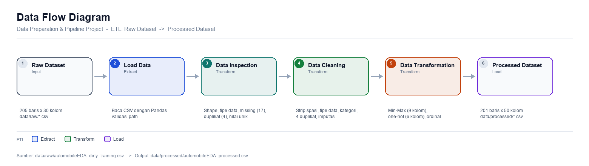
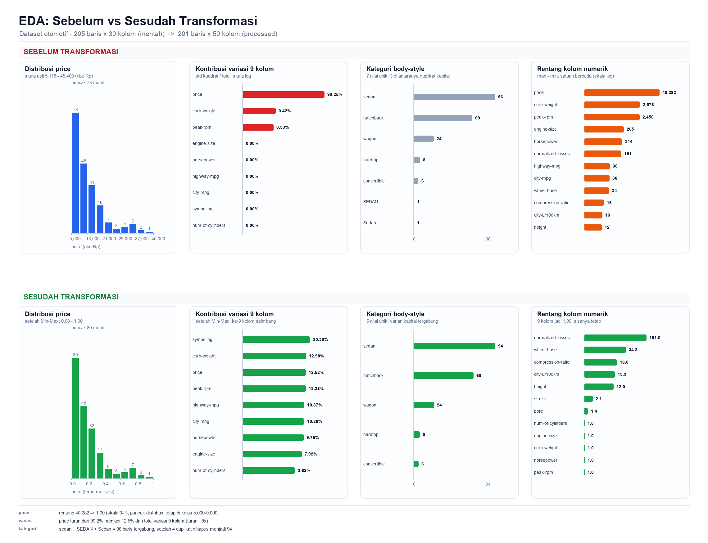

# Data Preparation & Pipeline Project



## 1. Sumber Dataset

| File | Lokasi | Peran |
|---|---|---|
| `automobileEDA_dirty_training.csv` | `data/raw/` | Input pipeline |
| `automobileEDA.csv` | `dataset/` | Referensi original |
| `automobile_processed.csv` | `dataset/` | Referensi clean (pembanding hasil) |

## 2. Struktur Folder

```
.
├── data/
│   ├── raw/automobileEDA_dirty_training.csv
│   └── processed/automobileEDA_processed.csv   # output pipeline
├── documentation/                              # diagram & chart EDA
├── src/pipeline.py                             # pipeline ETL
├── tools/                                      # skrip bantu dokumentasi
├── requirements.txt
└── README.md
```

## 3. Kondisi Awal Dataset

| Aspek | Nilai |
|---|---|
| Ukuran awal | 205 baris × 30 kolom |
| Total missing values | 17 sel |
| Duplicate records | 4 baris |

**Kolom dengan missing values:**

| Kolom | Missing |
|---|---|
| transaction_date | 2 |
| make | 2 |
| num-of-doors | 2 |
| stroke | 4 |
| horsepower | 3 |
| price | 3 |
| horsepower-binned | 1 |

## 4. Permasalahan yang Ditemukan

- **Missing values** pada 7 kolom (lihat tabel di atas).
- **Duplicate records** — 4 baris identik penuh.
- **Penulisan kategori tidak konsisten** (huruf besar/kecil):
  - `make`: `ALFA-ROMERO`, `Audi`, `BMW` vs `alfa-romero`, `audi`, `bmw`
  - `body-style`: `SEDAN`, `Sedan`, `sedan`
  - `drive-wheels`: `AWD`, `RWD` vs `fwd`, `rwd`
  - `fuel-system`: `MPFI`, `Mpfi`, `mpfi`
- **Whitespace berlebih** — nilai `make` seperti `dodge  `, `mercury  `, `porsche  `.
- **Format tanggal campuran** pada `transaction_date`: `2025-01-01`, `02/01/2025`, `01-03-2025`, `04-Jan-2025` bercampur dalam satu kolom.
- **Kolom kategorikal masih teks** — `num-of-doors` (two/four), `num-of-cylinders` (two…twelve), dan kolom nominal lain yang perlu di-encode.
- **Skala numerik belum seragam** — `curb-weight`, `engine-size`, `price`, `horsepower`, dll masih dalam satuan asli sehingga perlu normalisasi.

## 5. Data Cleaning

| Permasalahan | Metode | Alasan |
|---|---|---|
| Nama kolom & sel teks berpadded spasi | `str.strip()` | Menyatukan nilai yang sebenarnya identik |
| `stroke`, `horsepower`, `price` bertipe teks | `pd.to_numeric()` | Harus numerik agar bisa dinormalisasi |
| Kategori tidak konsisten | `str.lower()` + pemetaan kata → angka | Mencegah kategori palsu (`sedan` vs `SEDAN`) |
| 4 baris duplikat | `drop_duplicates()` | Tidak menambah informasi, hanya bias distribusi |
| Missing numerik | Isi **median** | Distribusi skewed, median lebih tahan outlier |
| Missing kategorikal | Isi **modus** | Data nominal tidak punya urutan |
| `transaction_date` | Kolom dibuang | Bukan atribut kendaraan, format campur |

Hasil: **205 → 201 baris**, **30 → 29 kolom**, **17 → 0 missing value**.

## 6. Data Transformation

| Transformasi | Kolom | Alasan |
|---|---|---|
| **Min-Max Scaling** | `symboling`, `curb-weight`, `engine-size`, `horsepower`, `peak-rpm`, `city-mpg`, `highway-mpg`, `price`, `num-of-cylinders` | Menyeragamkan skala 0–1 agar tidak ada fitur yang mendominasi |
| **One-hot encoding** | `body-style`, `drive-wheels`, `aspiration`, `engine-type`, `engine-location`, `fuel-system` → 27 kolom | Data nominal tanpa urutan |
| **Binary encoding** | `num-of-doors` (two=0, four=1) | Hanya 2 nilai |
| **Ordinal encoding** | `horsepower-binned` → `horsepower_ordinal` (0/1/2) | Kategori berurutan |
| **Frequency encoding** | `make` (22 merek) → `make_freq` | Kardinalitas tinggi, hindari 22 kolom dummy |

Kolom yang **tidak** di-scaling: `length` & `width` (sudah 0–1), `diesel` & `gas` (biner), serta kolom bersatuan konsisten (`wheel-base`, `bore`, `stroke`, `height`, `normalized-losses`, `compression-ratio`, `city-L/100km`).

## 7. Contoh Sebelum & Sesudah

| Kolom | Sebelum | Sesudah |
|---|---|---|
| `price` | 13.495 | 0,2080 |
| `horsepower` | 111 | 0,2944 |
| `num-of-cylinders` | `four` (4) | 0,2000 |
| `num-of-doors` | `two` | 0 |
| `body-style` | `convertible` | `body-style_convertible` = 1 |
| `horsepower-binned` | `Medium` | `horsepower_ordinal` = 1 |
| `make` | `alfa-romero` | `make_freq` = 0,0149 |



## 8. Hasil

| Tahap | Baris | Kolom | Missing |
|---|---|---|---|
| Dataset mentah | 205 | 30 | 17 |
| Setelah cleaning | 201 | 29 | 0 |
| Setelah transformation | 201 | 50 | 0 |

Output: **`data/processed/automobileEDA_processed.csv`** — dibuat otomatis setiap kali pipeline dijalankan, dan dataset mentah di `data/raw/` tidak pernah diubah.

## 9. Cara Menjalankan

```bash
pip install -r requirements.txt
python src/pipeline.py
```

Pipeline mencetak hasil inspeksi, cleaning, dan transformasi ke terminal, lalu menyimpan output ke `data/processed/`.

## 10. Penjelasan Singkat Alur ETL

| Tahap | Proses |
| :---- | :---- |
| **Extract** | `read_data()` — membaca `data/raw/automobileEDA_dirty_training.csv` |
| **Transform** | `inspect_data()` → `clean_data()` → `transform_data()` — inspeksi, cleaning, dan transformasi |
| **Load** | `save_data()` — menyimpan hasil ke `data/processed/` |

`run_pipeline()` merangkai kelima fungsi tersebut menjadi satu eksekusi
end-to-end (lihat diagram alur di bagian atas README).
